# Automação de Pedidos de Empréstimos - UiPath

Robô desenvolvido no **UiPath Studio** que lê uma planilha de solicitações de empréstimo, envia cada pedido pelo sistema web **UiBank** e grava o resultado de volta na planilha: taxa aprovada, motivo da recusa ou exceção de negócio.

## Demonstração

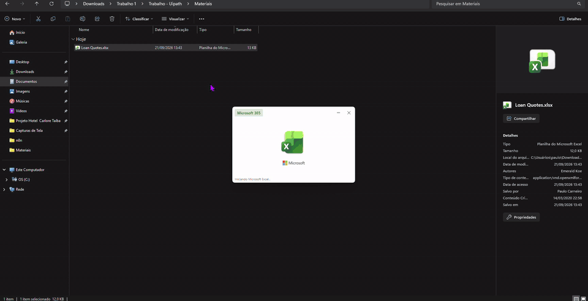

## O que o robô faz

1. **Lê a planilha** `Loan Quotes` para um DataTable (`dtLoanQuotes`).
2. **Faz login no UiBank** com a credencial `SistemaFaturas`, guardada no Gestor de Credenciais do Windows. Nenhuma senha fica no código.
3. **Navega até o formulário**: Products > Loans > Apply For A Loan.
4. **Para cada solicitação**:
   - valida o e-mail do solicitante;
   - preenche e envia o formulário (e-mail, valor, prazo, renda anual e idade);
   - identifica se o empréstimo foi **aprovado** ou **recusado** com o *Check App State*;
   - captura a taxa e a mensagem de aprovação, ou o motivo da recusa.
5. **Grava o resultado** nas colunas `LoanRate`, `Message` e `Result` da planilha.

## Estrutura do workflow

```
AutomacaoEmprestimosUiBank
├── Ler Planilha Loan Quotes                      -> dtLoanQuotes
└── Chrome UiBank-Welcome (https://uibank.uipath.com/login)
    ├── Get Username/Password                     -> Credencial (SistemaFaturas)
    ├── Login: Username, Password, Sign In
    ├── Navegação: Products > Loans > Apply For A Loan
    ├── Para Cada Solicitação de Empréstimo (dtLoanQuotes)
    │   └── Se E-mail For Válido
    │       ├── Processar Solicitação
    │       │   ├── Type Into: Email, Loan Amount, Income, Age
    │       │   ├── Select Item: Loan Term
    │       │   ├── Click: Submit Loan Application
    │       │   └── Check App State 'Empréstimo Recusado'
    │       │       ├── Solicitação Recusada  -> Message = motivo, Result = "Recusado"
    │       │       └── Solicitação Aprovada  -> LoanRate = taxa, Message = confirmação, Result = "Sucesso"
    │       └── Pular Linha - E-mail Inválido -> Message = "E-mail não informado", Result = "Exceção de Negócio"
    └── Gravar Mensagens na Planilha              <- dtLoanQuotes
```

O código completo está em [`AutomacaoEmprestimosUiBank.xaml`](AutomacaoEmprestimosUiBank.xaml).

## Regras de negócio

| Cenário | Message | Result |
|---|---|---|
| E-mail vazio ou sem `@` | `E-mail não informado` | `Exceção de Negócio` |
| Empréstimo recusado pelo UiBank | Motivo exibido pelo sistema | `Recusado` |
| Empréstimo aprovado | Mensagem de confirmação | `Sucesso` (taxa gravada em `LoanRate`) |

A validação do e-mail acontece antes de qualquer ação no site, então uma linha inválida não ocupa tempo de navegação.

## Destaques

- **Credencial segura**: usuário e senha vêm do Gestor de Credenciais do Windows e a senha é digitada como `SecureString`.
- **Check App State** para decidir entre aprovação e recusa sem depender de tempo fixo de espera.
- **Tratamento da mensagem de aprovação**: o texto capturado é cortado antes de "Apply For Another Loan", ficando só a mensagem útil.
- **Gravação única** da planilha no fim, com todo o DataTable atualizado.

## Fluxos

### Leitura da planilha e credencial
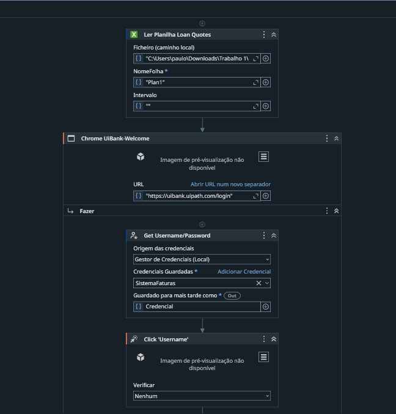

### Login no UiBank
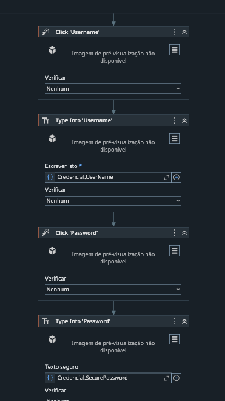

### Loop e validação do e-mail
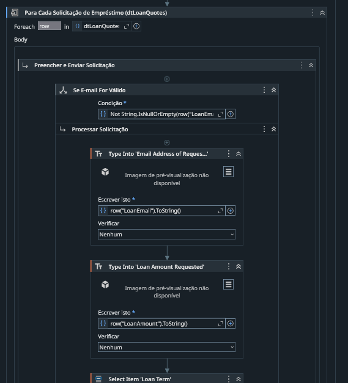

### Preenchimento do formulário
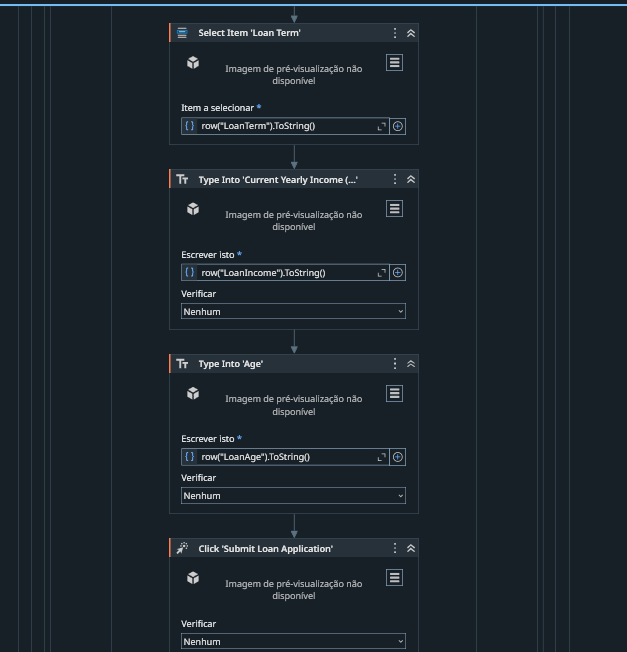

### Solicitação recusada
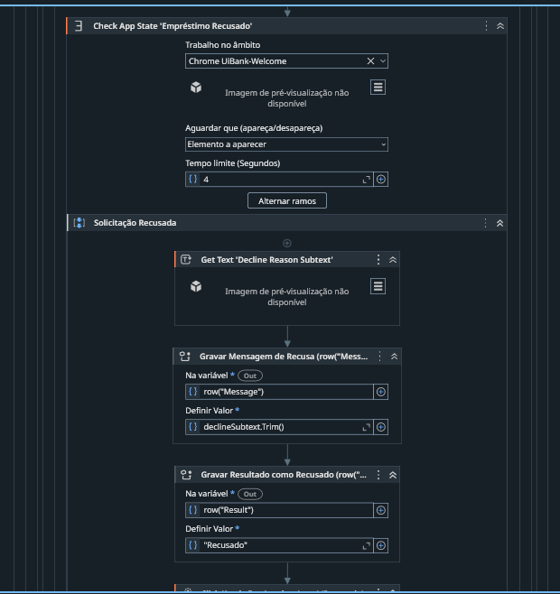

### Solicitação aprovada
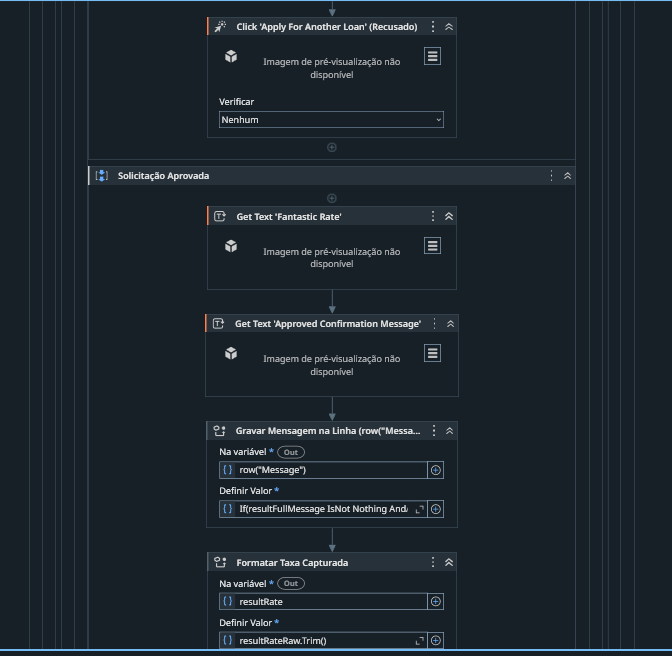
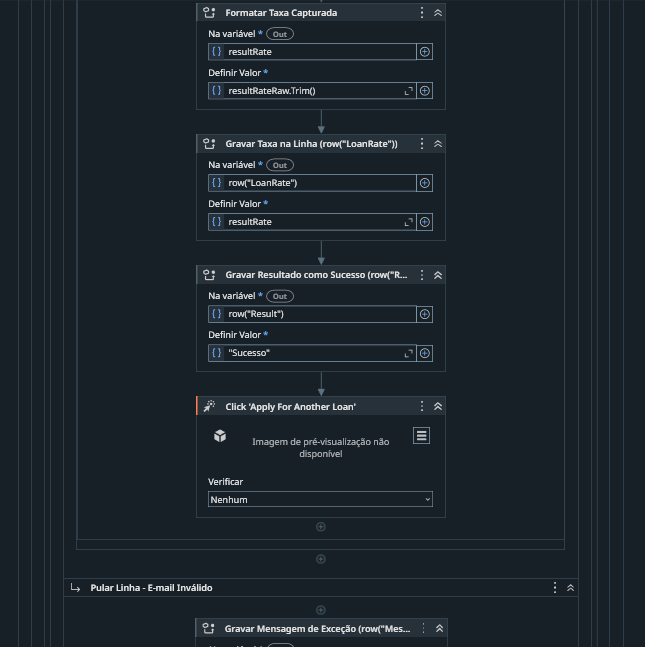

### E-mail inválido
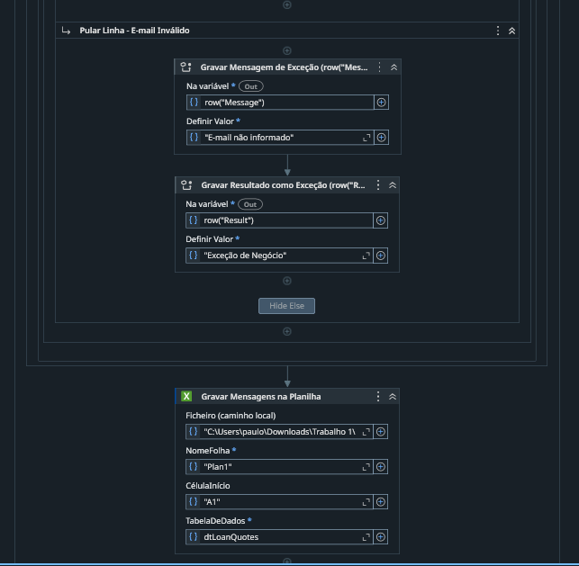

### Gravação na planilha
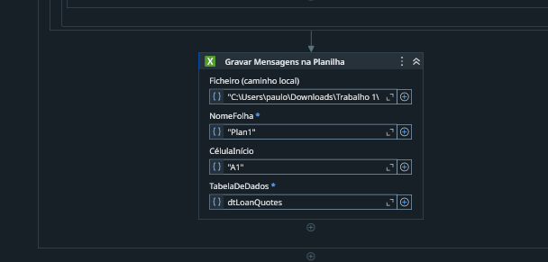

## Resultado

### Antes
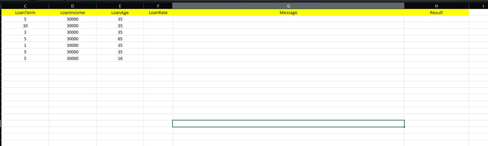

### Depois
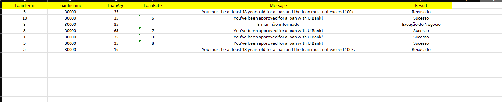

## Tecnologias

- UiPath Studio
- UiPath.UIAutomation.Activities
- UiPath.Excel.Activities
- UiPath.System.Activities
- Sistema de testes [UiBank](https://uibank.uipath.com/login)

## Autor

Paulo Victor Martins Carneiro
